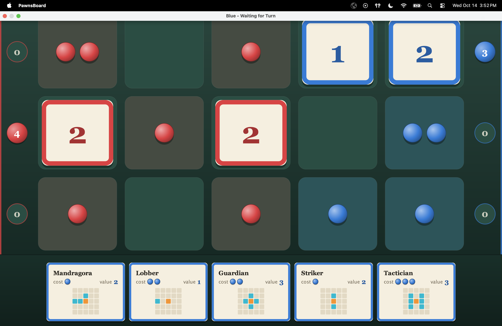
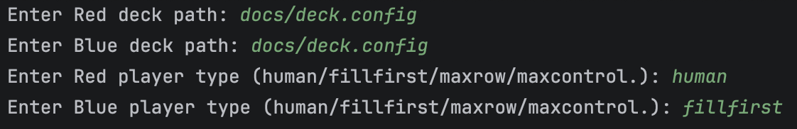

# Pawnsblood Board Game

## Overview

Pawnsblood Board Game is a two-player strategy card game built in Java, with a Swing interface, AI opponents, and a JUnit test suite. Players place cards to spread influence across the board and compete to control rows. The game is inspired by Queen's Blood, the card game in Final Fantasy VII Rebirth.

Built with @rachelelevathingal for CS3500 (Object-Oriented Design) at Northeastern University, with the work split about evenly between us. I contributed heavily to the core game model, including the cell and card classes, starting the game and taking turns, and the read-only view of the game. I also focused on the AI strategies, the controller and player classes, deck loading, high-contrast mode, and the increase and decrease influence effects. Since the course ended, I've continued improving the project on my own: I redesigned the interface, fixed bugs in passing and game over, and added tests for the game rules (see Portfolio updates).

## Running the Game
**Requirements**: Java 11. IntelliJ IDEA is recommended.

The program takes four arguments: Red's deck file, Blue's deck file, Red's player type, and Blue's player type. A player type is human or the name of an AI strategy (FillFirst, MaxControl, MaxRowScore).

**From the jar**:
`java -jar pawnsblood-board-game.jar docs/deck.config docs/deck.config human human`

**From IntelliJ**:
1. Open the project folder and set the Project SDK to Java 11 (File → Project Structure → Project).
2. Open `src/pawnboard/PawnsBoard.java` and create a run configuration for its main method.
3. Set the program arguments, for example:

4. Run it. One window opens for each player.

## How to play

Red owns the pawns in the leftmost column, and Blue owns the pawns in the rightmost column. Red goes first.

**On your turn,** you draw a card, then either place a card or pass.

**To place a card,** click it in your hand, click a cell on the board, and press **C** to confirm. You can only place a card on a cell that holds your own pawns, and the cell needs at least as many pawns as the card's cost (1–3).

**Influence:** each card has a 5×5 influence grid with the card at the center. When placed, its influence spreads to nearby cells. It adds one of your pawns to an empty cell, adds a pawn to a cell you already own (up to 3), or takes over the opponent's pawns.

**Scoring:** for each row, each player's card values are added up. The player with the higher total in a row earns those points. A tied row scores for nobody.

**Winning:** the game ends when both players pass back to back. The player with the most points wins.

### Controls

| Action | Input |
|---|---|
| Select or deselect a card | Click it in your hand |
| Select or deselect a cell | Click it on the board |
| Confirm the move | **C** |
| Pass the turn | **P** |
| Switch to high-contrast mode and back | **H** |

### Reading the screen

| Element | Meaning |
|---|---|
| Red and blue tokens on a tile | Pawns; up to 3 per cell |
| Tinted tile | Territory owned by that player |
| Card on the board | A placed card, framed in its owner's color, showing its value |
| Gold outline | The selected card or cell |
| Filled score token beside a row | That player is currently winning the row |
| Outlined score token | That player is not winning the row |

On cards in your hand, the influence grid shows the card's position in **orange** and the cells it influences in **cyan**.

## Architecture

The game follows **Model–View–Controller**, so the rules, the display, and the input handling can each change without affecting the others.

- **Model** (`PawnGameImpl`) holds the board, decks, hands, and turns, and enforces every rule. It never refers to the interface.
- **Views** (`BoardPanel`, `HandPanel`, `ScorePanel`, `PawnGameTextualView`) only draw the game state.
- **Controller** (`PawnsGameController`) turns clicks and key presses into model actions and responds to model events such as turn changes and game over.

Design patterns and principles used:

- **Strategy:** the AI strategies share the `PawnBoardStrategy` interface, so any strategy can be plugged into an AI player. Influence effects use the same idea, so a new effect is one new class.
- **Observer:** three kinds of listeners keep the parts in sync without tying them together. Views watch the model through `GameObserver`, the controller watches the model through `ModelStatusListener`, and the controller watches the views through `PlayerActionListener`.
- **Template method:** `GameFrame` is an abstract class that sets up the window layout, and `RedFrame` and `BlueFrame` fill in the player. `BoardPanel` does all of the drawing and takes its colors from overridable methods, so `HighContrastBoardPanel` is a small subclass that only changes colors.
- **Interface segregation:** `ReadonlyPawnsGame` exposes only methods that read the game, and `PawnsGame` adds the ones that change it. The AI receives the read-only interface, so it can inspect the board but can't change it. The strategy decides on a move, and the `MachinePlayer` carries it out through the full model.

## Project structure

### Game code (`src/pawnboard/`)

| Folder | Key files | Purpose |
|---|---|---|
| `pawnboard/` | `PawnsBoard.java` | Entry point; reads the command-line arguments and starts the game |
| `model/` | `PawnGameImpl`, `PawnsGame`, `ReadonlyPawnsGame` | The game state and rules, plus the full and read-only interfaces to them |
| | `PawnCell`, `Cell`, `PawnCard`, `Card` | Board cells and cards |
| | `Player`, `Cost`, `Count`, `InfluenceType` | Enums for players, card costs, pawn counts, and influence types |
| `controller/` | `PawnsGameController`, `GameController` | Turns clicks and key presses into game actions, and responds to turn changes and game over |
| | `ModelStatusListener`, `PlayerActionListener` | Listener interfaces connecting the model, controller, and views |
| | `CardInitializer` | Loads decks from card files |
| `player/` | `UserPlayer`, `HumanPlayer`, `MachinePlayer` | Human and AI players; the AI plays the moves its strategy chooses |
| `strategy/` | `PawnBoardStrategy`, `Move` | The strategy interface and the move a strategy returns |
| | `FillFirstStrategy`, `MaximizeRowScoreStrategy`, `MaxControlStrategy` | The three AI strategies |
| `influences/` | `InfluenceEffect` | The interface every influence effect implements |
| | `DefaultInfluence`, `UpgradeInfluence`, `DecreaseInfluence` | The default, increase, and decrease effects |
| `view/` | `GameFrame`, `RedFrame`, `BlueFrame` | The window for each player |
| | `BoardPanel`, `HandPanel`, `ScorePanel` | The board, the player's hand, and the row scores |
| | `HighContrastBoardPanel` | The high-contrast board |
| | `PawnGameTextualView` | The text version of the board |
| | `GameObserver`, `GameWindow`, `GameView`, `HighlightPanel`, `PlayerActionPublisher` | View interfaces |

`src/pawnboard/` also contains `strategy-transcript-first.txt` and `strategy-transcript-score.txt`, which record the moves the Fill First and Maximize Row strategies consider.

### Other folders

| Folder | Contents |
|---|---|
| `test/` | JUnit tests and mocks (see [Testing](#testing)) |
| `docs/` | Deck files: `deck.config` (20 cards), `biggerDeck` (more cards, with duplicates), `triplefile` (each card three times) |
| `GameScreenshots/` | Screenshots of the game |

### Class Invariant : 
- INVARIANT: the board does not have null values
-  We decided to enforce this because it prevents null pointer
exceptions as there cannot be any null values and ensures that
the board data is consistent.

## Testing

The project uses **JUnit 4**. Run all tests in IntelliJ by right-clicking the `test` folder and choosing **Run All Tests**.

- `PawnGameTest` covers the model's public methods and the AI strategies. The strategies are tested against `MockPawnGame`, a stand-in model with a board set up for each test, so a test can check exactly which move a strategy picks.
- `PawnCellTest`, `PawnCardTest`, and `CardInitializerTest` cover cells, cards, and deck loading.
- `NewInfluenceTest` covers the increase and decrease influence effects.
- `PawnGameRulesTest` covers the game rules end to end: passing and game over, behavior after the game ends, legal and illegal placements, drawing, scoring, and full games against the AI.
- `PawnGameControllerTest` covers how the controller responds to clicks, key presses, and model events. These tests are currently disabled (see [Known limitations](#known-limitations)).

### Mocks

Some tests replace real parts of the game with mocks: simple stand-ins that return controlled values, so one part can be tested without the rest of the game around it.

- **`MockPawnGame`** is a stand-in model whose board is set up by each test. The strategy tests run against it, so a test can check exactly which move a strategy picks in a known situation.
- **The controller mocks** (`MockUserPlayer`, `MockGameWindow`, `MockBoardPanel`, `MockHandPanel`, `MockGameInterface`, and `MockPawnGameController`) stand in for the player, the window, the panels, and the model. They let `PawnGameControllerTest` check the controller's behavior without opening any windows or playing a real game.
  This works because each part depends on interfaces rather than specific classes. The controller only knows it has a model, a player, and a window, so a test can hand it mocks instead of the real ones.

## Design decisions

The project was built in phases during the course, and the design was revised along the way:

- **Typed values:** raw integers and strings were replaced with enums for card costs, pawn counts, and influence types, so invalid values can't be represented.
- **Encapsulation:** internal operations such as drawing a card and applying influence were made private, so other code can't call them out of order.
- **Safer AI:** strategies were changed to take the read-only model instead of the mutable one, so an AI can't accidentally change the game.
---

## Portfolio updates

After the course, I kept working on the project to make it portfolio-ready:

- **Interface redesign:** the board, hand, and score panels were redrawn as a tabletop, with pawns as game tokens, cards framed in each player's color, hover and selection feedback, and score tokens that show who is winning each row.
- **Game-over fixes:** the model originally used one flag for both "not started" and "finished," so ending the game made the board unreadable and crashed the game-over screen. It also never reset a pass when a card was played, so passes far apart could end the game. Game over is now tracked separately, playing a card resets the passing streak, and the model rejects moves after the game ends.
- **Game-over display:** the game-over dialog now appears in every game mode, including human vs. human, and both window titles show the result.
- **Reliable AI turns:** when an AI has no legal move, or its move is rejected, it passes instead of stalling the game.
- **Reliable keyboard input:** key presses no longer depend on which panel has focus, so C, P, and H work right after a pop-up closes.
- **High-contrast rewrite:** high-contrast mode is now a small subclass that overrides the board's colors and reuses all of its drawing code. This also fixed clicks being handled twice in that mode. It can be toggled even after the game ends.
- **Rules tests:** `PawnGameRulesTest` covers each of these fixes so they can't come back.
---

## Known limitations

- **Increase and decrease influences** (shown in **green** and **purple** on a card's influence grid) are in progress and don't yet apply correctly during play.
- **The AI only looks one move ahead.** A stronger AI would simulate the opponent's possible responses before choosing a move.
- **Only the board switches to high contrast;** the hand and score panels keep their normal colors.
- **The controller tests are disabled.** The controller depends on the concrete Swing window class rather than the `GameWindow` interface, so the mock window can't stand in for it. The fix is to move the window operations the controller needs into the interface.